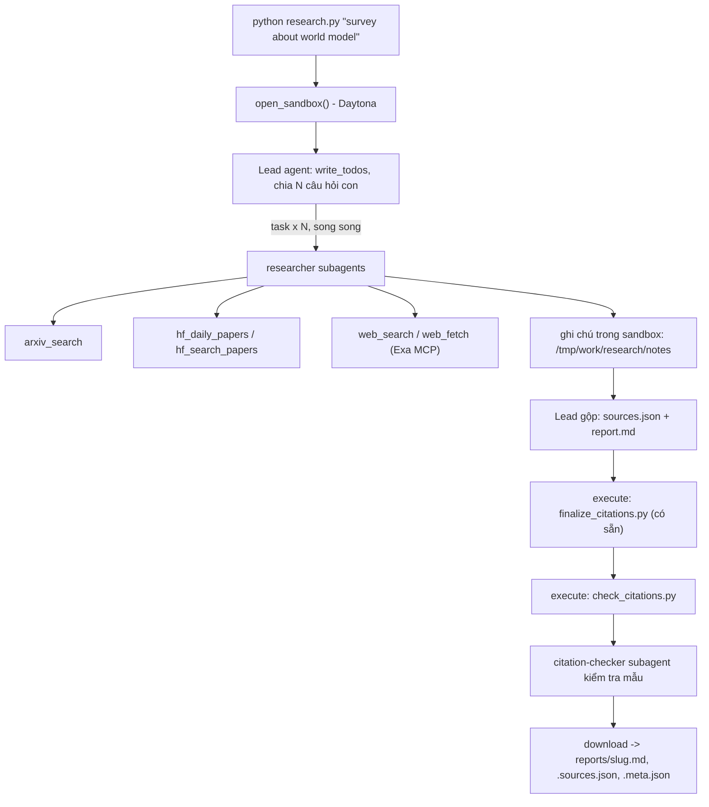

# Deep Research Agent (Deep Agents + Sandbox)

Lab dựng một **hệ thống deep research đa tác tử**: người dùng chỉ cần nhập một chủ đề (ví dụ `survey about world model`), hệ thống tự lập kế hoạch, giao việc cho nhiều subagent, tìm tài liệu trên arXiv, Hugging Face và web, rồi viết một **báo cáo có trích dẫn**.

Hình thức: **bài thực hành cá nhân**. Ngôn ngữ lập trình: Python 3.11 trở lên.

## 1. Mục tiêu học tập

Sau lab, bạn có thể:

1. Dựng agent bằng thư viện Deep Agents (LangChain): công cụ (tool), system prompt, subagent, backend.
2. Dùng **sandbox** (Daytona) làm không gian làm việc và nơi chạy mã cho agent; hiểu vì sao khóa API và công cụ mạng phải nằm ở phía host chứ không nằm trong sandbox.
3. Viết công cụ gọi API ngoài **chịu được giới hạn tốc độ** (retry, backoff, jitter, `Retry-After`).
4. Thiết kế quy trình đa tác tử: lead chia nhỏ câu hỏi, giao cho N researcher chạy song song, tổng hợp và kiểm tra trích dẫn.
5. Tạo báo cáo có thể kiểm chứng: mọi khẳng định có `[n]` trỏ tới một nguồn có thật.

## 2. Hệ thống làm gì



Nguồn dữ liệu:

| Nguồn | Dùng để |
|---|---|
| arXiv API `https://export.arxiv.org/api/query` | Tìm bài theo từ khóa, sắp theo ngày |
| Hugging Face Daily Papers `/api/daily_papers` | Bài đang "trending": upvotes, githubRepo, summary |
| Hugging Face papers search `/api/papers/search?q=` | Tìm bài theo chủ đề |
| Web qua Exa MCP (`web_search_exa`, `web_fetch_exa`) | Blog, survey, trang dự án, nội dung đầy đủ của một URL |

## 3. Cấu trúc thư mục

```
Lab/
├── README.md  GUIDE.md  RUBRIC.md  REPORT_TEMPLATE.md   tài liệu
├── topics.md                 5 chủ đề cần chạy
├── requirements.txt  .env.example  .gitignore
├── model.py                  CÓ SẴN - không sửa: tạo mô hình LLM từ biến môi trường
├── sandbox.py                CÓ SẴN - không sửa: sandbox Daytona (hoặc Docker), upload, download
├── self_check.py             CÓ SẴN - không sửa: tự kiểm tra trước khi nộp (python self_check.py)
├── finalize_citations.py     CÓ SẴN - không sửa: script chạy trong sandbox, tự sinh `## References` và đánh số lại trích dẫn
├── tools.py                  SINH VIÊN CÀI ĐẶT: retry + 5 công cụ nguồn dữ liệu
├── agents.py                 SINH VIÊN CÀI ĐẶT: prompt, subagent, lead agent
├── research.py               SINH VIÊN CÀI ĐẶT: script chính
├── check_citations.py        SINH VIÊN CÀI ĐẶT: kiểm tra trích dẫn, chạy TRONG sandbox
└── reports/                  báo cáo sinh ra (bạn commit vào repo nộp)
```

Mỗi tệp "SINH VIÊN CÀI ĐẶT" là **pseudo-code chạy được** (import được): các hàm có docstring mô tả việc cần làm, các `TODO n` đánh số theo `GUIDE.md`, thân hàm đang `raise NotImplementedError`.

## 4. Cài đặt

```bash
python3 -m venv .venv && source .venv/bin/activate      # Python 3.11+
pip install -r requirements.txt
cp .env.example .env                                     # rồi điền khóa CỦA BẠN
```

Bạn cần ba loại khóa (điền vào `.env`, **không bao giờ commit** `.env`):

| Khóa | Lấy ở đâu | Ghi chú |
|---|---|---|
| LLM (`LAB_MODEL` + khóa nhà cung cấp) | Nhà cung cấp bạn chọn (OpenAI, Anthropic, Google, OpenRouter, Ollama...) | Mô hình **phải hỗ trợ tool calling**. Chép tên mô hình từ tài liệu của nhà cung cấp. |
| `DAYTONA_API_KEY` | https://app.daytona.io | Kiểm tra gói miễn phí / credit hiện hành. Không có tài khoản hoặc hết credit: đặt `SANDBOX=docker` để chạy sandbox trong container Docker cục bộ (xem `.env.example`). |
| `EXA_API_KEY` (khuyến nghị) | https://dashboard.exa.ai/api-keys | Có thể chạy không khóa, nhưng bản miễn phí của MCP bị giới hạn tốc độ rất nhanh. |

## 5. Làm bài

Làm theo thứ tự (chi tiết trong `GUIDE.md`):

1. `check_citations.py`: khởi động nhẹ, thuần Python.
2. `tools.py`: viết `with_retry` và 5 công cụ. Thử riêng từng công cụ: `python tools.py`.
3. `agents.py`: viết prompt, subagent và lead agent.
4. `research.py`: ghép tất cả; chạy một chủ đề:

```bash
python research.py "survey about world model"
```

Kết quả nằm ở `reports/survey-about-world-model.md` cùng `.sources.json` và `.meta.json`.

## 6. Chủ đề và nộp bài

- Chạy đủ **5 chủ đề** trong [`topics.md`](topics.md), mỗi chủ đề một lần.
- Commit mã nguồn và toàn bộ `reports/`, đẩy lên một **public repo** GitHub và nộp link.
- Kiểm tra trước khi nộp: chạy **`python self_check.py`** (không tốn token): nó kiểm tra đủ 5 báo cáo, `meta.json`, trích dẫn bằng `check_citations.py` của bạn, và không có `.env`/khóa nào trong git.
- Cách chấm: xem [`RUBRIC.md`](RUBRIC.md).

## 7. Thời gian, chi phí và an toàn

- Dùng một mô hình **rẻ nhưng hỗ trợ tool calling**, và **đặt giới hạn** (số lần gọi mô hình/công cụ cho lead và subagent, `recursion_limit`): một prompt hỏng có thể khiến agent lặp rất lâu. Đây là hạng mục 2.5 của `RUBRIC.md`.
- Kết quả có tính ngẫu nhiên: cùng một mã có thể cho báo cáo hợp lệ ở lần này và trích dẫn lỗi ở lần sau. Hãy sửa **prompt và mã**, không sửa tay báo cáo.

- Mỗi lần chạy tốn token LLM và thời gian sandbox. `tokens` trong `meta.json` chỉ đếm tin nhắn của lead, chưa gồm subagent, nên chi phí thật cao hơn. `open_sandbox()` luôn dừng và xóa sandbox khi kết thúc, kể cả khi lỗi. Đừng bỏ qua nó.
- **Không đưa bí mật vào sandbox.** Sandbox không ngăn được prompt injection hay việc đẩy dữ liệu ra mạng; một trang web độc hại có thể khiến agent chạy lệnh bên trong sandbox. Vì vậy mọi công cụ gọi mạng và mọi khóa ở lại phía host.
- Nội dung lấy từ web là **dữ liệu không đáng tin**: agent không được làm theo chỉ dẫn nằm trong đó.

## 8. Bài nộp: cách chạy và đọc kết quả

Sinh viên: Nguyễn Hải Nam (2A202602476). Năm báo cáo trong `reports/` được sinh bằng `gpt-6-luna` (OpenAI), sandbox Docker.

### Cài đặt và chạy

```bash
python -m venv .venv
source .venv/bin/activate                  # Windows PowerShell: .\.venv\Scripts\Activate.ps1
pip install -r requirements.txt
cp .env.example .env                       # Windows: Copy-Item .env.example .env
```

Điền `.env`: `LAB_MODEL=openai:gpt-6-luna`, `OPENAI_API_KEY`, `EXA_API_KEY`, và `DAYTONA_API_KEY` (hoặc `SANDBOX=docker`
khi dùng Docker cục bộ; Docker Desktop phải đang chạy). Sau đó:

```bash
python tools.py                                   # thử 5 công cụ nguồn dữ liệu, không cần LLM
python research.py "survey about world model"     # một chủ đề, khoảng 5-15 phút
```

### Đọc thư mục `reports/`

Mỗi chủ đề có ba tệp, cùng tên `<slug>`:

| Tệp | Nội dung |
|---|---|
| `<slug>.md` | Báo cáo theo `REPORT_TEMPLATE.md`; `## References` do `finalize_citations.py` sinh trong sandbox |
| `<slug>.sources.json` | Các nguồn được trích: `{n, id, url, title, date, source}` |
| `<slug>.meta.json` | Model, thời gian, `subagent_calls` (số lần lead gọi `task`), số lần gọi từng tool, token của lead, `n_sources`, `source_families` |

| Chủ đề | Giao việc | Nguồn | Họ nguồn |
|---|---|---|---|
| survey about world model | 5 | 22 | hf-daily, hf-search, web |
| survey about reinforcement learning for LLM reasoning | 7 | 20 | arxiv, hf-daily, hf-search, web |
| survey about LLM agents and tool use | 5 | 23 | arxiv, hf-daily, hf-search, web |
| survey about video and multimodal generation | 7 | 25 | arxiv, hf-search, web |
| survey about efficient inference and small language models | 6 | 22 | arxiv, hf-daily, hf-search, web |

### Kiểm tra

```bash
python self_check.py                                                  # READY to submit
python check_citations.py reports/<slug>.md reports/<slug>.sources.json
pip install -r requirements-dev.txt && python -m pytest -q            # 43 test offline: không mạng, không LLM
```

### Những điểm đáng chú ý trong cài đặt

- **arXiv:** các researcher chạy song song nên khoảng cách 3 giây được giữ bằng một khóa luồng. Khi arXiv vẫn trả 429
  sau mọi lần retry, `arxiv_search` tạm ngừng 5 phút và trả lỗi ngay để researcher đổi nguồn.
- **Exa:** phát hiện cờ rate limit trong `result._meta` (HTTP 200) và retry. Khóa được che trong mọi chuỗi `ERROR`.
  `Retry-After` dài hơn 10 phút (hết hạn mức) thì báo lỗi ngay thay vì chờ vô ích.
- **Timeout cho LLM:** `model.py` tạo client OpenAI không có timeout, nên một kết nối treo có thể chặn cả lần chạy (đã
  gặp khi chạy thật). `research.py` gắn timeout 180 giây và 2 lần retry cho mỗi request.
- **Validator chặt hơn GUIDE:** ngoài 6 quy tắc trích dẫn, `check_citations.py` còn kiểm tra nhãn họ nguồn khớp URL
  (`arxiv` cần `arxiv.org/abs/`, `hf-*` cần `huggingface.co/papers/`) và cấu trúc của template (đủ các phần, 3-6 chủ đề,
  tiêu đề nằm riêng dòng). Agent phải tự sửa báo cáo cho tới khi validator in OK; không báo cáo nào được sửa tay.
- **Giới hạn:** lead có 150 lần gọi model và 300 lần gọi tool mỗi lần chạy (kèm `thread_limit`); mỗi subagent có 40 và
  60; `recursion_limit` của lead là 1000.

### Mở rộng (GUIDE mục 6)

| Tính năng | Cách bật | Ghi chú |
|---|---|---|
| Giới hạn theo thread | luôn bật | `thread_limit` cho lead, bên cạnh `run_limit`: vẫn đúng khi chạy tiếp từ checkpoint |
| Ngân sách token dùng chung | luôn bật; `LAB_TOKEN_BUDGET` (mặc định 3 000 000) | Một bộ đếm có khóa luồng cho lead và mọi subagent chạy song song: cảnh báo ở 80 %, dừng êm ở 100 %. Mỗi lần chạy subagent còn bị chặn ở 600 000 token. Tổng thật được ghi vào `meta.json` ở trường `tokens_all_agents` |
| Bộ nhớ dài hạn | `LAB_MEMORY=1` | `/memory/AGENTS.md` được định tuyến (`CompositeBackend`) về thư mục `memory/` trên host và tồn tại giữa các lần chạy. Chỉ lead được ghi (subagent bị `FilesystemPermission` chặn), và chỉ ghi bài học về quy trình. Tắt mặc định vì nội dung web có thể "cài" chỉ dẫn vào prompt của các lần chạy sau; `memory/` nằm trong `.gitignore` |
| Nén ngữ cảnh chủ động | luôn bật | Lead có tool `compact_conversation` và được gợi ý dùng sau khi gộp xong `sources.json` |

Kiểm chứng thật (chủ đề thử "survey about mixture of experts language models", không nằm trong `reports/`): lead dùng
651 nghìn token nhưng tổng của mọi agent là 1,30 triệu; lead tự ghi một bài học vào `memory/AGENTS.md`; với
`LAB_TOKEN_BUDGET=150000` agent cảnh báo ở 134 nghìn, dừng êm, thoát mã 1 và không ghi báo cáo nào. Năm báo cáo trong
`reports/` được sinh trước khi thêm phần mở rộng, nên `meta.json` của chúng chưa có trường `tokens_all_agents`.
